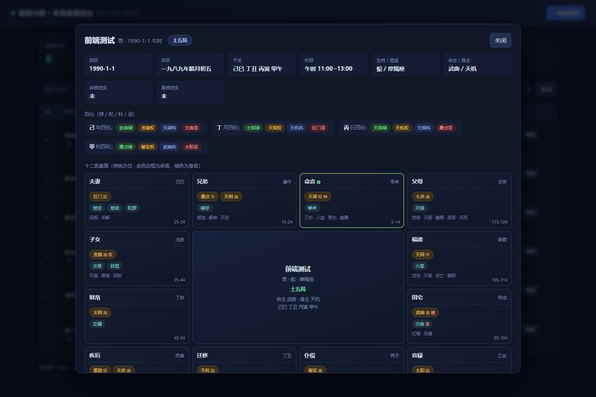
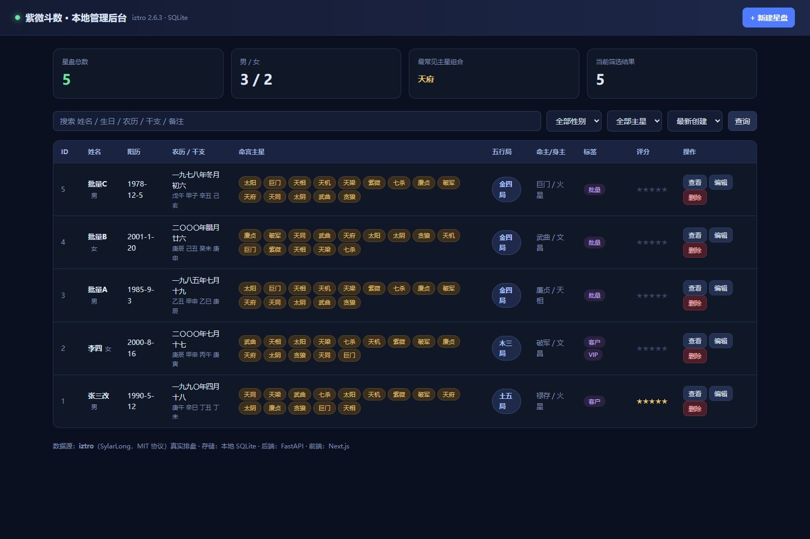

# 紫微斗数 · 本地管理后台

> 基于开源排盘库 [iztro](https://github.com/SylarLong/iztro) 的紫微斗数排盘与本地数据管理系统。
> Python + FastAPI 后端 · Next.js 14 + TypeScript 前端 · SQLite 存储。

一个可以本地部署、能查能改的紫微斗数星盘管理工具。
输入生辰即可生成完整十二宫盘面，支持检索、编辑、批量导入与运限查询。



---

## ✨ 功能

- **真实排盘** —— 集成 iztro，输出十二宫、十四主星、辅星、杂曜、四化、庙旺亮度、大限年龄
- **十二宫盘面** —— 按传统方位布局，命宫高亮、身宫标记、主星带亮度、每宫显示大限年龄段
- **检索筛选** —— 关键词（姓名/生日/农历/干支/备注）、性别、主星、标签，6 种排序，分页
- **增删改查** —— 新建自动排盘、编辑姓名/标签/备注/评分、软删除与恢复
- **批量导入** —— 单次最多 500 条
- **运限查询** —— 大限 / 流年 / 流月
- **审计与备份** —— 所有变更留痕，内置数据库备份/恢复工具
- **自动化测试** —— 后端 76 项 + 前端浏览器端到端 21 项 + 交付自检 19 项

---

> **代码规模**：3035 行（业务 2524 + 测试 511）· 29 个文件 · 13 个 REST 接口 · 3 张数据表

## 🧱 技术栈

| 层 | 技术 | 说明 |
|---|---|---|
| 前端 | Next.js 14 (App Router) + React 18 + TypeScript | 通过 rewrites 代理后端，无需处理跨域 |
| 后端 | Python 3.10+ / FastAPI / Pydantic v2 | 13 个 REST 接口，自动生成 OpenAPI 文档 |
| 数据库 | SQLite（WAL 模式） | 零部署，单文件 |
| 排盘引擎 | [iztro](https://github.com/SylarLong/iztro) 2.6.x（MIT） | Node.js 库，通过桥接脚本调用 |

**为什么同时有 Python 和 Node？**

iztro 是 JavaScript 生态中最成熟的紫微斗数排盘库，而本项目后端使用 Python。
因此采用 **Python 主控 + 按需调用 Node 排盘** 的桥接设计：

- 单次排盘：启动一次 node 子进程，stdin/stdout 交换 JSON
- 批量排盘：一次进程调用处理全部条目，避免反复启动开销
- 封装在 `backend/engine.py`，将来若要替换排盘引擎，只需改动这一层

---

## 🚀 快速开始

### 前置要求

- Node.js ≥ 18
- Python ≥ 3.10

### 1. 安装依赖

```bash
# Node 依赖
npm install

# Python 依赖
pip install fastapi uvicorn pydantic
```

### 2. 启动后端（端口 8701）

```bash
cd backend
python -m uvicorn main:app --host 127.0.0.1 --port 8701
```

### 3. 构建并启动前端（端口 8700）

```bash
npm run build
npm run start
```

打开 <http://127.0.0.1:8700>

> 接口文档：<http://127.0.0.1:8701/docs>

### Windows 一键启动

```bash
start.bat
```

---

## 📖 API

| 方法 | 路径 | 说明 |
|---|---|---|
| GET | `/api/health` | 健康检查 |
| GET | `/api/engine` | 排盘引擎状态（版本/许可） |
| POST | `/api/charts` | 新建星盘（自动排盘并入库） |
| GET | `/api/charts` | 列表（`q` / `gender` / `star` / `tag` / `page` / `size` / `sort`） |
| GET | `/api/charts/{id}` | 详情（含十二宫完整数据） |
| PATCH | `/api/charts/{id}` | 修改（姓名 / 备注 / 标签 / 评分 / 性别） |
| DELETE | `/api/charts/{id}` | 软删除 |
| POST | `/api/charts/{id}/restore` | 恢复已删除 |
| GET | `/api/charts/{id}/horoscope?date=` | 运限（大限 / 流年 / 流月） |
| POST | `/api/charts/import` | 批量导入（≤500 条） |
| GET | `/api/stats` | 统计（总数 / 性别 / 主星 Top / 五行局分布） |
| GET | `/api/audit` | 审计日志 |
| GET | `/api/export` | 导出全部 JSON |

**新建示例**

```bash
curl -X POST http://127.0.0.1:8701/api/charts \
  -H "Content-Type: application/json" \
  -d '{
    "name": "张三",
    "gender": "男",
    "year": 1990, "month": 5, "day": 12,
    "time_index": 7,
    "note": "测试",
    "tags": "客户"
  }'
```

`time_index` 取值 `0`–`12`，对应早子时、丑时……亥时、晚子时。

---

## 🗄 数据库设计

```sql
charts            星盘主表
  ├─ 基础：name, gender, solar_date, time_index
  ├─ 排盘结果：lunar_date, chinese_date, time_name, zodiac,
  │           sign, soul, body, five_elements, soul_branch, body_branch
  ├─ 业务：note, tags, star_rating
  ├─ 原始数据：raw_json      ← 完整排盘结果，换引擎不影响历史数据
  └─ 管理：is_deleted（软删除）, created_at, updated_at

chart_palaces     十二宫（便于「按主星查人」这类查询）
audit_log         审计日志
```

**三个设计取舍：**

1. **`raw_json` 存全量** —— 将来更换排盘引擎，历史数据不受影响
2. **十二宫独立成表** —— 支持按星曜检索（例如「找出所有命宫紫微的客户」）
3. **软删除** —— 误删可恢复

---

## 🧪 测试

```bash
# 后端：76 项检查（需先启动后端）
python scripts/test_api.py

# 前端：21 项浏览器端到端验收（需先启动前后端 + 已构建）
python scripts/test_frontend.py

# 交付自检：19 项（文件完整性 / 依赖 / 服务 / 核心链路）
python scripts/final_acceptance.py
```

当前状态：**后端 76/76 ✅ ｜ 前端 21/21 ✅ ｜ 交付自检 19/19 ✅**

| 套件 | 覆盖范围 |
|---|---|
| `test_api.py` | 健康检查、真实排盘、参数校验、搜索/筛选/分页/排序、详情、修改、删除/恢复、运限、批量导入、统计、审计、导出 |
| `test_frontend.py` | 首页渲染、新建（含排盘）、搜索、性别筛选、详情（十二宫 12 宫 / 命宫高亮 / 主星徽章）、编辑、删除 |
| `final_acceptance.py` | 文件完整性、依赖声明、服务可用、创建→查询→修改→删除全链路 |

> 前端测试依赖 [Playwright](https://playwright.dev/python/)：
> `pip install playwright && playwright install chrome`

---

## 📁 项目结构

```
ziwei-admin/
├── backend/
│   ├── engine.py         排盘引擎桥接层（调用 iztro）
│   ├── db.py             SQLite 数据层（CRUD + 审计 + 统计）
│   └── main.py           FastAPI 路由
├── components/
│   └── ChartDetail.tsx   十二宫盘面组件
├── lib/
│   ├── api.ts            API 客户端
│   └── types.ts          类型定义
├── app/
│   ├── page.tsx          主页面
│   ├── layout.tsx
│   └── globals.css       全局样式
├── scripts/
│   ├── iztro_bridge.js   Node 桥接脚本
│   ├── test_api.py       后端测试
│   ├── test_frontend.py  前端验收
│   ├── final_acceptance.py 交付自检
│   └── backup.py         备份/恢复工具
├── data/                 SQLite 数据（运行时生成，已 gitignore）
└── screenshots/          界面截图
```

---

## 🛠 运维工具

```bash
python scripts/backup.py backup            # 备份（使用 SQLite 在线备份 API）
python scripts/backup.py list              # 列出备份
python scripts/backup.py restore <文件名>   # 恢复（恢复前自动备份当前库）
```

---

## ⚠️ 已知限制

1. **时辰粒度** —— 使用 13 个传统时辰（早子时～晚子时），未做真太阳时校正
2. **单机单用户** —— 无登录鉴权，定位为本地工具
3. **依赖 Node** —— 排盘需 Node 环境；若需纯 Python 实现，需重写排盘算法
4. **运限范围** —— 已支持大限/流年/流月，未暴露流日/流时

---

## 界面预览

| 首页列表 | 新建星盘 |
|---|---|
|  |  |

| 十二宫盘面 | 编辑 |
|---|---|
|  |  |

---

## 📄 License

本项目代码以 [MIT License](LICENSE) 发布，可自由用于商业项目。

排盘算法与星曜数据来自 [iztro](https://github.com/SylarLong/iztro)，同样为 MIT 协议。
第三方依赖（iztro 等）的声明见 [NOTICE.md](NOTICE.md)。

---

## 🙏 致谢

- [iztro](https://github.com/SylarLong/iztro) —— 完整的紫微斗数排盘引擎与星曜数据
- [FastAPI](https://fastapi.tiangolo.com/) · [Next.js](https://nextjs.org/) —— 构建本项目的基础框架
